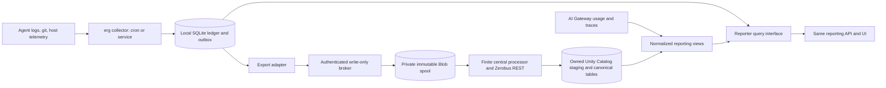

---
ddx:
  id: erg.architecture
  status: draft
  authoring:
    home: repo
  links: [prd]
---
# Architecture

## Scope

Two independently runnable components: a collector and a reporter. The collector
runs once under cron or continuously as a service. The reporter serves the same
UI against local SQLite data or data centralized in Databricks Unity Catalog.
Central full-content delivery uses a write-only HTTPS broker and a finite central processing job; neither belongs in the reporter process.

Enrolled one-shot capture shares the durable historian and retained enrichment
with the background service. Bodies commit before optional enrichment, with
native-ID deduplication and no automatic content opt-in. The polling CLI does not
start filesystem watching or the inference listener: those require the managed
service. A private absolute launcher binds the installed runtime, discovery
settings, state directory and ledger without depending on shell PATH or checkout.

Confirmed product direction: collectors push to Databricks; local reporting also
works; the initial audience is one operator viewing enrolled machines. Reporting
can later be hosted centrally without changing the collection destination.
The central destination is the private production `erg` catalog, with `ingest`,
`telemetry`, `admin` and `reporting` schemas. Broad developer access through inherited grants is unacceptable.
Central export and app deployment remain paused until the production destination
and required permissions are verified; local capture and reporting continue.
Enrollment/authentication qualification, effective grants and the retention policy remain rollout gates. Assigned Intune Macs are the fleet scope; Erik is the sole ordinary human reader/administrator.
This document is a design draft, not implementation authorization.

The PRD governs agent coverage, dated costs, work definitions and privacy. Its
functional requirements remain in scope; delivery proceeds in bounded increments.
Billing-grade metering, a managed erg SaaS and custom multi-user authorization
are outside scope. Databricks access remains governed by Unity Catalog.

## Level 1: System Context

| Element | Purpose | Boundary |
|---------|---------|----------|
| Operator | Inspect usage, costs, sessions, output and machine load | Local browser or private centrally hosted reporter |
| Agent runtimes | Produce session logs or native telemetry | Claude Code, Codex and Fizeau adapters |
| Git and host monitors | Supply work evidence and machine state | Read-only collection; actual coverage retained |
| Databricks | Centralize host observations alongside gateway evidence | Authenticated ingest and governed SQL queries |

## Level 2: Container Diagram

| Component | Technology | Responsibilities |
|-----------|------------|------------------|
| Collector | Python; portable collection remains standard-library-only | Source discovery, normalization, checkpoints, sampling and durable export queue |
| Local ledger and outbox | SQLite | Persist observations before checkpoint advancement; retain pending export records |
| Reporter | Python reporting API plus existing HTML/JavaScript UI | Query selected backend, apply common reporting semantics, serve UI; never schedule collection |
| Central store | Unity Catalog Delta tables and SQL views | Store erg observations, read gateway evidence, expose normalized reporting relations |
| Delivery client | Standard-library HTTPS and SQLite revision journal | Forward-only full content, exact persisted batches, separate accepted/materialized/projected receipts |
| Broker | Python 3.12 Azure Function and private Blob | Verify enrolled device identity; acknowledge only immutable durable acceptance |
| Central processor | Finite Databricks bundle job | Scan durable spool, forward through Zerobus REST, verify materialization, canonicalize and publish receipts |

## Deployment

- **Local:** collector and reporter share a host, with separate processes. SQLite
  remains sufficient for offline reporting. Databricks export is optional.
- **Local plus central collection:** the collector commits locally, then pushes
  asynchronously to Databricks. Stopping the reporter does not stop collection;
  a Databricks outage does not stop local reporting.
- **Reporting over Unity Catalog:** the reporter can run locally and query
  Databricks SQL, or be hosted privately near Databricks. The UI and reporting
  contract remain the same. A Databricks App is a candidate hosting option,
  not a prerequisite or an approved deployment action.
- Each collector has a durable machine identity distinct from hostname and an
  installation identity. Credentials authorize writes; machine labels alone
  do not authenticate a collector. Readers and writers use separate privileges.
- Local SQLite files stay on local disks. Central tables use Unity Catalog
  storage. Do not share a SQLite file across machines.

## Data Flow

1. An adapter reads a bounded source window and emits normalized observations.
2. A local transaction persists observations, pending exports and source progress.
   Source progress cannot advance beyond durable local capture.
3. Local reports query the ledger without waiting for export.
4. Export retries pending records with stable identities. Delivery acceptance
   and confirmed central visibility are separate states where the sink is
   asynchronous; an HTTP success is not proof of durable availability.
5. Databricks normalization combines erg and gateway evidence into common
   reporting relations. Retries and multiple observations of a call cannot
   inflate usage totals.
6. Either reporter backend answers the same bounded report request. The browser
   receives the same result shape and does not hold Databricks credentials.

## Central Data Model

Full native session events and observed inference requests are distinct facts.
`session_events` retains source order, bodies, revisions, provenance and availability.
`inference_calls` mirrors the production Unity Gateway 18-column core, with namespaced
erg extensions for session/account/usage/context evidence. Unknown native HTTP fields
remain NULL; transcripts never become fabricated wire payloads or Gateway IDs.
The complete mapping and wire protocol are governed by
[CONTRACT-006](contracts/CONTRACT-006-central-delivery.md).

Zerobus JSON REST into erg-owned staging tables is the selected central ingestion
path. The bundle processor verifies complete records before canonical publication;
HTTP acceptance, Zerobus acceptance, materialization and projection are separate.
The production synthetic landing target is
`erg.zerobus_landing.delivery_items_raw`, with a schema-specific managed root
`abfss://landing@examplelanding.dfs.core.windows.net/`. This is an isolated service
landing account, not a change to the private session corpus or spool. Only that
new account uses reviewed selected-network public endpoint reachability: default Deny,
bypass None, no anonymous access/shared keys/arbitrary IP or subnet rules, regional
`AzureDatabricksServerless.EastUS2` NSP rule in Learning/Transition mode and the
exact access-connector instance exception. Transition falls back to the account
firewall; it is not Enforced. Regional networking is not workspace identity;
connector IAM and UC grants remain separately required. Compatibility and valid
outside-network denial require live proof after network-change review. The
2026-10-25 synthetic qualification passed both; exact evidence is recorded in
`../04-build/evidence/synthetic-cloud-qualification-2026-10-25.json`.

The Mac contract, private `/Volumes/erg/ingest/spool` and control volume, existing
`erg.telemetry` tables and original attempted landing table remain unchanged.
The bundle's qualification target selects `ingest_schema=zerobus_landing` while
its schedule stays PAUSED and default execution false. No real uploads or fallback
transport are enabled by configuration preparation.

Gateway-owned inference/usage tables remain unchanged. Exact identifiers reconcile
mirrors; approximate timestamp/token matches remain uncertain. OTel interoperability
is optional future work, not the fleet wire format. The older parameterized SQL
metadata exporter is a prototype and does not provide full corpus delivery.

## Central ownership and execution boundaries

The coordinated infrastructure plan is `organization-infra`, branch
`codex/erg-central-plan`, `docs/helix/04-build/erg-central-implementation-plan.md`.
Infrastructure owns hosting, Blob/IAM/network, Entra/enrollment, the private catalog,
schemas, external locations/volumes/grants, warehouse and Intune release rollout.
Erg owns protocol fixtures, uploader and broker application code, table/view DDL,
and the Databricks bundle job. Tables/jobs must not also be created by Terraform.

The broker is a Python-v2 Function ZIP rooted at `function_app.py`, disabled by
`ERG_INGEST_ENABLED=false` until enrollment and access qualification pass. Settings:
`ERG_STORAGE_ACCOUNT_URL`, `ERG_SPOOL_CONTAINER`, `ERG_CONTROL_CONTAINER=control`, `ERG_SPOOL_PREFIX=v1`,
`ERG_TENANT_ID`, `ERG_INGEST_AUDIENCE`, `ERG_REQUIRED_ROLE=Erg.Collector`, and
`ERG_ENROLLMENT_REGISTRY_BLOB`. Caller-supplied labels are never identity proof.
The processor reads infra's `/Volumes/erg/ingest/spool` and writes separate
`/Volumes/erg/ingest/control` receipts. One finite five-minute bundle job starts
PAUSED with `max_concurrent_runs=1`. Zerobus uses a dedicated processor identity;
secret scope/key references may exist while the secret remains absent/unqualified.
No implicit notebook OAuth or collector cloud SELECT is assumed. Federation may
replace server-only credentials only after qualification. No alternate ingestion
path is substituted silently if Zerobus fails qualification.

New delivery modules have explicit boundaries:

| Module | Responsibility | Allowed dependencies |
|---|---|---|
| `erg/delivery_protocol.py` | Exact wire bytes, limits, digest and chunk validation | Standard library only |
| `erg/delivery_journal.py` | Atomic capture revision snapshots, immutable local batches and receipts | Standard library, delivery protocol |
| `erg/delivery_client.py` | Independent bounded HTTPS delivery/retry worker | Standard library, journal/protocol |
| `erg/delivery_inventory.py` | Bounded metadata inventory and labeled sample estimates | Standard library, protocol |
| `central/erg_central/` | Durable acceptance, canonical processing and central adapters | Pure protocol plus central-only SDKs |

`python3 -B scripts/check-delivery-boundaries.py` enforces the new client boundaries.
Central SDKs must not enter the dependency-free Mac package. The local proof uses
private temporary files and synthetic records; it cannot qualify production Entra,
networking, Zerobus storage access, retention or central/local reporting parity.

## Reporting Semantics

The shared report model covers sessions, calls, usage buckets, costs, work,
metrics and source health. SQLite and Databricks adapters return the same typed
results; backend-specific SQL and aggregation stay behind that interface.
Large central queries filter and aggregate in Databricks rather than sending all
raw history to the browser. Cross-backend fixtures must produce equivalent
results for equal input and the same catalog/definition versions.

Gateway usage is separate evidence from execution traces. Preserve invocation
and request identities, including retry distinctions. A session parent, local
client span and gateway server span are not three chargeable calls. Prefer
explicit correlation; classify uncertain matches rather than suppressing them
by token count and timestamp alone. Reconcile again when late evidence arrives.

Retain fresh input, cache read, cache write and output separately; reasoning is
reported as a subset where the source defines it that way. Reconciliation rules
must state each source's token semantics. Prices are effective-dated external
data; every cost has provenance and unknown cost stays visible.

Commits are unique work evidence across hosts; host sightings are separate.
Agent edit activity is distinct from committed or landed work. Metric rollups
select sources using coverage as well as priority, retain missingness and derive
active duration from observed intervals rather than assuming complete hours.

## Module Boundaries

**Source Applicability**: source; portable Python capture/client and central-only application runtimes are implemented here.
**Integration Owners**: Erg owns protocol/client/application schemas/jobs; infra owns cloud resources, enrollment and fleet rollout.
**Construction Policy**: CLI/service construct independent components; capture transactions perform no network IO; central SDKs never enter the Mac package.
**Boundary Check**: `python3 -B scripts/check-delivery-boundaries.py` checks delivery imports; `python3 -B -m unittest discover -s tests` checks behavior. The checker does not certify all legacy module boundaries.

| Module | Responsibility / Owned Types | Public API | Allowed Dependencies | Forbidden Dependencies |
|---|---|---|---|---|
| `erg/collect.py`, `erg/history.py` | Native discovery, source progress and safe event bodies | scan, put, safe_event | Standard library, local capture context | Reporter availability or network delivery in capture transaction |
| `erg/store.py` | SQLite schema and transactions | connect, open_readonly, initialize_db | Standard library, local initialization | UI/network side effects |
| `erg/delivery_protocol.py` | Wire bytes, digest, identities and chunks | batch, record_items, validate_batch, reconstruct | Standard library | Source scraping, storage, SDKs, reports |
| `erg/delivery_journal.py` | Atomic snapshots, batches and receipt cursors | enroll, prepare_one, next_batch, accept, reconcile_status, status | Standard library, protocol | Network, capture scraping, reports |
| `erg/delivery_client.py` | HTTPS retry worker | HTTPS, helper_token, step, run_worker | Standard library, protocol/journal | Source scraping, UI, cloud SDKs |
| `erg/delivery_inventory.py` | Bounded read-only volume estimate | inventory | Standard library, protocol | Upload, upstream logs, reporting |
| `central/erg_central/` | Broker, auth, spool/CAS, DDL, processor and reference reducer | Receiver, EntraVerifier, Processor, run, statements | Protocol, central-only Azure SDKs, Spark | Mac SDK installation, source scraping, implicit admin credentials |
| `erg/server.py`, reporting modules and static UI | Bounded reports and presentation | Reports and HTTP endpoints | Local/report backend adapters | Collection scheduling, browser-held cloud credentials |
| `erg/cli.py`, `erg/service.py` | Component construction and lifecycle | main, service entrypoints | Component public APIs | Embedded accounting rules or SDKs on Macs |

## Quality Attributes

| Attribute | Required behavior | Verification |
|-----------|-------------------|--------------|
| Replay safety | Repeating capture or export leaves report totals unchanged | Replay and duplicate-delivery fixtures on both backends |
| Independence | Reporter downtime and network loss do not prevent local capture | Kill/restart and offline-recovery scenarios |
| Crash recovery | No source checkpoint advances beyond persisted observations | Fault injection around the local transaction and export acknowledgement |
| Accounting | Explicit identity wins over heuristics; late evidence is reconciled | Retry, multi-hop, multiple-user and late-arrival fixtures |
| Coverage | A 30-second sample never represents 60 observed minutes | Sparse and overlapping-source interval fixtures |
| Privacy | Prompt/response bodies are excluded by default; credentials never enter erg records | Sensitive-content fixtures through capture, queue, export and query |
| Portability | Portable collection works under the project's Python floor | Existing macOS/Linux Python matrix plus packaged collector checks |
| Backend parity | Equal facts and definitions produce equal reports | Identical dataset fixtures on SQLite and Databricks |

The session ledger contract bounds export batches by encoded bytes and record count and bounds SQL execution time. Pending data is retained; disk budgets, query latency targets and outage-retention capacity still require measurement before an unattended rollout.
Queue exhaustion must be visible; pending records cannot be silently discarded.
Cron and service modes use the same pipeline. Continuous mode adds cadence and
shutdown handling. Cron reports its actual sampling coverage. Source timeouts,
non-overlapping execution and actionable partial-failure exit status are required.

## Decisions and Tradeoffs

| Decision | Status | Rationale / consequence |
|----------|--------|-------------------------|
| Separate collector and reporter | Confirmed | Either can stop without stopping the other |
| Push through durable broker; also report locally | Confirmed | HTTPS acceptance is independent of local capture/reporting |
| One operator initially | Confirmed | Private local UI and governed Databricks access; no custom tenant model |
| Full native sessions plus Gateway-compatible inference facts | Selected | Preserve independent raw content, unknown fields and exact reconciliation |
| Local ledger plus durable outbox | Implemented locally; central delivery inactive | Offline operation and replay; uses local disk and needs explicit retention policy |
| SQLite and Unity Catalog query adapters | Proposed | Same reporting experience, with backend-specific SQL isolated |
| Standard-library Mac JSON/HTTPS client | Selected | Central Azure dependencies are packaged separately; no binary encoder on Macs |

## Remaining qualification

B1–B9 sequencing is maintained in the existing implementation plan. Zerobus REST
is selected; do not silently substitute a different sink. Application protocol,
local outbox/reference proof and deployment artifacts can be implemented without
qualifying cloud access. The live Entra certificate bootstrap/rotation/revocation,
private storage route, production schema comparison, full content round trip,
retention decision, central throughput/cost and reporting parity remain gates.
No real content export or infrastructure apply follows from local fixture results.

## Sources

Original interoperability references were checked 2026-10-16. Production discovery
is recorded in the coordinated infrastructure plan (2026-10-24); it is not proof
of live broker/auth/storage qualification. Zerobus REST documentation was checked
2026-10-25.

- D1: [Inference table schema](https://docs.databricks.com/aws/en/ai-gateway/inference-tables-beta).
- D2: [Unified trace table and client ingestion](https://docs.databricks.com/aws/en/ai-gateway/unified-trace-table).
- D3: [Unified trace table schema](https://docs.databricks.com/aws/en/ai-gateway/unified-trace-table-reference).
- D4: [Zerobus OTel ingestion](https://docs.databricks.com/aws/en/ingestion/opentelemetry/).
- D5: [Zerobus OTel table mapping](https://docs.databricks.com/aws/en/ingestion/opentelemetry/table-reference).
- D6: [Gateway usage table](https://docs.databricks.com/aws/en/ai-gateway/usage-tracking).
- D7: [Zerobus JSON REST and scoped OAuth](https://learn.microsoft.com/en-us/azure/databricks/ingestion/zerobus-ingest).

## Commit, usage and account evidence

Local attribution treats verified commits as work units independently of PRs.
Paired tool creation results and exact git objects supply relations; PR membership
is a second layer. Explicit tool working directories bound observed scopes, while
unsupported or conflicting evidence remains unknown. The reporter exposes native
session totals and peak request sizes across all canonical calls.

`accounting.py` keeps identities, quota events, bounded association metadata and
subscription charges separate. `account_probe.py` uses read-only local Codex account
RPC in an independent collector worker. Native log quota events and a Claude
SessionStart identity hook add source evidence. Creator, current profile and payer
are separate roles; account associations retain provenance. `rates.py` computes
dated standard API-equivalent value from data artifacts, with unknown-model and
cache-duration coverage. Reference valuations do not become historical charges.
Fees are aggregated once per subscription billing period before any usage join.
CONTRACT-002 and CONTRACT-003 govern these local reporting semantics. Central
export and deployment remain paused on the private-catalog permission hold.

`routes.py` owns sanitized session route evidence, explicit Claude bridge owners,
metadata-only backfill and coverage/reason aggregation. Native metadata and
lifecycle observations carry their effective timestamps; active wrapper config
snapshots remain configuration-only. Profile discovery is independent of fast Pi
capture. Billing association remains in `accounting.py`; route/owner discovery
never creates subscription charges or aliases custom inference payers to app owners.

Retained events project Claude, Codex and Pi usage and edit metrics. Enrolled
scheduled enrichment reads source checkpoints and observed project directories
from the local ledger, while retaining Copilot/OpenCode legacy usage adapters,
host performance and repository enrichment. It does not reopen covered agent
histories. Unenrolled collection preserves its original source adapters.
Counter-only Codex events remain cumulative snapshots rather than fabricated
request rows. Projector version 2 upgrades old retained edit records through a
separate bounded queue without replaying usage, account or route attribution.
Decoding occurs outside the writer transaction; a content-hash check rejects
stale results. Pending edits pin bodies against retention. Errors retry and
unavailable bodies remain explicit; edit catch-up has separate health reporting.
Claude account capture remains bounded and synchronous before requests;
account-only aliases resolve only to verified provider-scoped accounts.

## Forward corpus and optional desktop boundary

The authorized local corpus extension retains compressed native events in the same
SQLite store, with transactionally committed source progress and stable native entry
identities. Pi lifecycle hooks supply fsynced incremental outbox batches; the collector
acknowledges them only after commit. Native polling provides independent coverage.
The local inference front door persists requests before forwarding, checkpoints
streaming responses and retains incomplete receipts. Unique response/model/machine
identity links native and server evidence; ambiguous matches remain separate.

Agent-content enrollment is forward-only. Existing source files baseline, automatic
agent-content expiry is off, and explicit expiry retains tombstones. Logical expiry
does not promise secure filesystem erasure. Content is served only through local
read-only history APIs. Corpus bodies are not in the existing central export journal.
The owned inference projection mirrors published inference-table fields and adds
explicit erg session, usage, retention and provenance extensions; it does not modify
Databricks-managed inference tables.

FEAT-001 is a later optional desktop source. Native helper selection and exact adapter
schema require a new ADR/contract before implementation. Desktop intervals remain
separate resources with separate versioned correlation links. Their desktop-only
retention/budget includes staged and pending payloads, with latest-revision acknowledgement
from every required destination gating expiry. Protected allocation pressure pauses
only desktop capture. Local-only desktop enrollment creates no central queue; no
existing agent-content retention or central access restriction is changed.

## GitHub evidence direction

Sessions supply causal evidence: a native tool call, its correlated successful
result, repository/task scope and a stable commit or PR identity. The implemented
Claude/Codex extractor already captures verified git commit and PR-creation results.
Git history establishes local commit facts, and the existing read-only GitHub feed
verifies commit-to-PR membership and current PR state. Commit-first linkage can cover
work performed before PR creation; time overlap, titles and branch names alone
cannot establish it. Failed or unpaired tool results remain unverified.

Proposed next expansion: apply the same evidence extraction to Pi tool activity and
GitHub connector calls, retaining source event/call references so the operator can
drill from a work fact to the captured trace. Separately enrich GitHub resources with
reviews, checks, issue links and merge outcomes through an incremental read-only
feed. Those facts can arrive outside an agent session and must remain useful without
inventing session attribution. Host/repository/object IDs establish resource identity;
updated/observed times and revisions preserve freshness, retries and changed outcomes.

Preserve source actors and causal provenance independently. An action using an
operator's GitHub credentials can still have been performed by an agent; a GitHub
login or User account type alone does not prove a human input. Reviews, CI success,
merge state and explicit feature/task links can support separate effectiveness
measures with coverage denominators. PR titles are display metadata, never proof
of feature completion or accepted code. Ambiguous or inaccessible links stay unknown.

This is the design direction requested during the title update, not an implementation
claim for reviews/checks, Pi/connector evidence extraction or new GitHub permissions.
Existing repository allowlists, private local evidence and central export hold remain.

### Independent managed local reporter

The macOS local reporter has a separate `dev.ddx.erg.reporter` user LaunchAgent,
configured through `erg reporter install/status/stop`. It runs only the SQLite
reporter, with an explicit loopback bind and database path, and never controls the
collector or model backend. launchd restarts a crashed reporter and launches it at
login. Readiness requires both a live managed PID and an HTTP health response with
the installed instance identity; a different listener is not reported as healthy.

Installations use immutable private runtime snapshots independent of collector
updates. Port conflicts and unrecognized jobs abort before service replacement.
Failed startup during upgrade restores the previous manifest and LaunchAgent;
success keeps the preceding snapshot and prunes older owned code versions. This is
local lifecycle support, not Linux/systemd distribution or central app deployment.

## Project catalog and cost allocation — design proposal

The operator selected a local project table for the initial implementation, with
master-project download from Databricks later and project assignments published
back for shared reporting. The first source does not depend on choosing the final
upstream master system. The exact proposed record/resolution interface is in
[the accounting contract](contracts/CONTRACT-003-accounting.md#proposed-project-accounting-extension).
This section is a design proposal; the tables and binding APIs are not implemented.

Keep three separate layers: captured usage/context, project catalog plus versioned
binding policy, and derived allocations/cost reports. The native `project` field
currently comes from directory/worktree heuristics and remains an observed hint.
It cannot become the business project key by renaming a folder or editing a report.
Preserve canonical request identity and apply project policy after deduplication.
A multi-project session has allocations by request/time, not one forced label.

Erg owns its normalized monetary evidence and reference-price snapshots. Reports
show API-equivalent estimates, native reported estimates, actual billed usage and
fixed subscription charges separately. Reference value is not incurred spend.
Subscription fees enter project expense only through a separately declared,
versioned allocation policy; its unallocated balance remains visible. Independent
pricing and assignment coverage prevent a known project from implying a known cost.

Proposed modules and integration ownership:

| Module | Owned types and public API | Allowed dependencies | Forbidden behavior |
|---|---|---|---|
| `erg/projects.py` (proposed) | Project, CatalogSnapshot, Binding, Allocation; `import_catalog`, `apply_bindings`, `preview`, `resolve` | Standard library, explicit SQLite connection and canonical work/context values | Reading native logs, pricing, network calls or UI dependencies |
| `erg/project_reports.py` (proposed) | `report(filters, catalog_revision, binding_revision)` | Canonical calls, project allocation API, existing rates/accounting APIs | Guessing identities or rewriting captured project/context |
| `erg/databricks.py` (existing, extended later) | Versioned project download and project-assignment outbox delivery | Existing authenticated transport and project import/export contract | Bypassing destination grants, inventing a second project master |
| `erg/cli.py`, `erg/server.py` (adapters) | Config validation/preview and reporting presentation | Project APIs and scoped configuration command submission | Embedding matching, cost allocation or source scraping rules |

The CLI owns construction. Initial configuration is applied through explicit CLI
commands/imports; reporter reads remain read-only. The UI presents project costs,
coverage, matching-rule explanations and a proposed-binding preview. A later UI
save action submits a typed configuration command through a private local command
inbox; the collector validates/applies it atomically and returns durable applied or
rejected status. The reporter must not mutate traces or start collection to apply
configuration. Offline commands remain visibly pending, not falsely successful.
That command surface needs same-origin/CSRF protection and is not part of the
first catalog/resolution implementation.

Implementation order and proof: local catalog plus atomic config import; binding
preview and deterministic per-call allocation; visible filtered cost/project views;
then inbound master sync and outbound allocation revisions. Each slice retains the
full eventual interface. Before source implementation handoff, add an AST import
boundary test for the proposed modules and run
`python3 -m unittest discover -s tests -p test_project_boundaries.py` alongside the
full suite. Tests must cover rename stability, conflicting rules, effective-time
changes, path boundaries, weighted conservation, alias reconciliation and replay.
Central sync remains behind the private-destination hold.

### First project-accounting implementation

The local catalog, explicit alias mappings, versioned configuration/import history,
repository/directory/session resolver, CLI preview/apply/retry path and read-only
Costs API/UI are implemented in `erg/projects.py` and `erg/project_reports.py`.
The module-boundary gate above exists and passes. Native context metadata is indexed
locally at history capture and can be rebuilt from retained records; source bodies
are not imported and folder hints remain separate. Read snapshots keep cost reports
and before/after previews consistent while capture continues. Reports apply weights
after canonical usage selection and expose source-overlap and price-coverage gaps.

The durable `project_allocations` export projection, master sync, verified work-item
selectors, interactive configuration submission and subscription-fee allocation
remain proposed. The current Costs endpoint computes allocations from catalog,
policy and recorded context at read time, with revision-aware caching. It does not
claim those remaining surfaces or historical billing tariffs are complete.

## Slack as intention evidence — feasibility note

Slack is installed locally, but erg has no Slack content adapter. Read-only structural probes identified local IndexedDB stores and validated WAL/SST
checksums. Message bodies have not been decoded or ingested; credentials were not
read. Desktop cache completeness has not been established. The planned optional desktop feature is scoped to
application activity, which does not establish
message content, user intent or a session-to-work causal link.

A future explicitly enrolled Slack adapter should preserve conversation/thread
resources separately from agent sessions, with workspace/channel/message IDs,
thread parentage, edits/deletion evidence, provenance and resource-scoped retention.
The operator prefers local cache discovery to avoid API authentication and
distribution requirements. A directory-only inventory found an app.slack.com
Chromium IndexedDB LevelDB store and associated blob storage; this does not prove
that cached message/thread records exist or establish their coverage. Investigate
read-only message/object-store schemas, stable identities and eviction behavior
before implementing a cache adapter. Do not extract or reuse cookies or tokens.
Treat cache coverage as observed partial evidence until independently established.
Any incremental, checkpointed adapter must share the background CPU budget; do not
add continuous cache scans or automatic LLM summarization to infer intent.

Project bindings can later target channel/thread resources. Link a Slack request to
an agent session/task/commit/PR through an explicit reference or declared binding;
timing similarity only proposes an association. A user's written request,
notification, reaction and reading activity are different evidence. Slack content
collection and central export are not enabled by this feasibility note.

Primary reference: [Slack message and thread retrieval](https://docs.slack.dev/messaging/retrieving-messages).

The Slack structural probe observed `sundryStorage` and `reduxPersistenceStore`.
A retained blob expands losslessly from about 1.16 MB to 4.20 MB, but the native
structured-clone decoder did not reconstruct its value. This does not establish
that the cache includes message/thread content. A version-aware Chromium reader
and observed edit/deletion/eviction behavior are still required before enrollment.
No Slack adapter, credential extraction or central export was added.

### Independent session summaries

`session_usage.py` owns the shared token, rate valuation, reported estimates and
account/route coverage accumulator. Work reports reuse it; the session endpoint
can compute the same metrics without loading PR metadata, human-input attribution
or other sessions' calls. SQLite narrows native identity candidates while keeping
global winner selection. Local/gateway receipts retain full canonical matching.
Full-session metrics and bounded detail use one read snapshot. Collector worker
CPU counters expose fixed phases separately from whole-process/helper totals.

### Bounded host-metric rollups and title discovery

`metric_rollups.py` maintains hourly per-source/per-tier count, sum and peak rows.
Raw metrics remain authoritative. Transactional triggers dirty both old and new
buckets, including deletes. No-op metric replays do not dirty caches. A rowid-bounded
seed captures existing local rows; concurrent inserts independently dirty their
buckets. CPU-bounded maintenance uses a separate ledger connection from history
capture, with rollback on capture failure. Derived maintenance errors do not stop
trace capture; reports fall back to raw metrics whenever cache completeness or
freshness is unproven. Cache selection and reads share a snapshot, and partial-hour
filters retain raw boundary samples. Fractional/text timestamps force raw fallback
until corrected/removed; the original coverage and source/tier selection stays.

Codex title reads use numeric update watermarks and include equal-timestamp rows.
JSONL title indexes tail only verified appends; replacements and shrinkage reset
progress. A fixed five-minute full reconciliation catches older edits even during
continuous appends. Source reads and parsing happen before the destination writer
transaction, and source progress is acknowledged only after commit. Unknown source
schemas retain full-read fallback; names never determine attribution or identity.

## Universal project reporting

The operator requires sessions → observed folders/agent projects → configured human
projects across every reporting view. The local master catalog remains authoritative
until upstream synchronization is implemented. CONTRACT-004-project-hierarchy governs
shared temporal allocation, per-request valuation, common filters and the UI migration.
Source project hints remain captured evidence, not inferred business-project IDs.

The local reporter now has a narrowly scoped project-metadata administration
endpoint. It requires loopback/same-origin JSON requests, expected configuration
revision, and preview/apply for folder bindings. Captured traces, usage facts and
billing evidence remain read-only to these actions. The collector is independent;
project creation or reassignment never starts inference, imports upstream history
or enables central export. Central master sync and remote hierarchy parity remain
separate delivery requirements.

### Durable incremental project reports

CONTRACT-005 governs the cold-read correction. `project_rollups.py` maintains
versioned hourly Usage payloads, per-session hourly cost cells and exact edge-hour
priced facts. Source changes enqueue hours; one pinned source snapshot is built
under CPU duty pacing and exposed through one atomic head update. Pending serials
survive intervening writes. Reporters read completed projections and expose lag,
warming and the active allocation revision. Their refresh path does not perform
source allocation/pricing. The worker is independent from capture threads and its
default 2% measured thread-CPU allowance reserves headroom under the 10% fleet
target; it does not replace sustained process-tree acceptance measurement.

## Shared dashboard over the Databricks corpus

The local reporter now serves the same dashboard at `/` (local ledger) and
`/databricks` (Databricks corpus). The previous raw trace browser remains at
`/databricks/traces`. A private, disposable SQLite read cache under
`databricks-reporting/` consumes only verified, materialized Unity Catalog delivery
items using the operator's existing production reader. It does not scan native
logs, copy local activity into the cache, upload records or change central schemas.

The cache requires a contiguous delivery sequence, validates item and reconstructed
payload digests, persists incomplete chunks across restarts and retains native
identities/revisions. Replay is idempotent; a changed immutable item fails closed.
Scope is pinned to workspace, namespace, enrollment and destination generation.
The cache supports the one configured operator profile and enrollment; it is not a multi-user or App-token reporting endpoint.
The reporter's loopback-only cloud routes do not expose its reader on the network.

Shared history/work/edit/canonical-call projections and project rollups populate
the cache. Both dashboards use the same Reports, project_scope, project_rollups,
project_reports and report_evidence code. The current local operator project catalog
and binding policy are a labelled configuration overlay, not a second independent
catalog. Published revisions remain visible during reallocation. Source bodies and
usage never fall back to the local retained ledger when cloud access fails.

SQL reads are bounded before inline materialization (eight MiB of escaped result
JSON and 10,000 items per page). SQL counts JSON string escaping and conservative
row framing before selecting rows, leaving headroom below the inline result limit. HTTP report reads use only completed cache rollups. Known signed local
materialization receipts suppress SQL polling when the cache has caught up. Idle
checks sleep for one minute; queries and projections run independently of capture
and the uploader. Cache backlog, native event time and refresh errors are explicit.
No Databricks App, new cloud compute service, credential, grant or schema is needed.

At the initial cloud dashboard rollout, additional account/billing and work/PR
metadata export awaited explicit authorization. The approved implementation below
supersedes that state. Display titles harvested outside the normalized observation
contract remain local metadata. No retained native session history is uploaded.

### Approved reporting evidence delivery — 2026-10-26

The operator explicitly authorized scoped work/PR, identity/binding, quota/reset
and recorded subscription-charge metadata export to the existing private erg
catalog. The existing independent uploader now publishes normalized allowlisted
observations as usage_evidence, work_evidence or account_evidence envelopes.
The immutable original enrollment, timestamp and inode/byte boundaries remain
unchanged. Only sessions already in the forward journal are eligible. Activity
and quota events must meet the original time boundary; current context and
account/PR headers may annotate those sessions. Unrelated sessions and accounts,
credentials, native retained bodies and old usage are excluded.

Metadata uses the existing signed protocol, broker, Zerobus path and Delta tables.
No additional grants, schemas or upload credentials are introduced. Event identity
and monotonically increasing observation revision make retries idempotent. Source
normalization is repeated before export and on cache import. The cloud cache
applies this evidence through the same store.ingest and canonical/reporting
projections as the local ledger, without creating an upload feedback loop.

Publisher scans use indexed kind/time selection, durable forward session scope,
version-aware sent markers and bounded queues; native publication takes priority.
Central reconciliation groups original signed batches by enrollment and bounded
item/byte budgets before shared Spark merges, while retaining each original batch
digest and receipt. This reduces sparse-batch overhead without changing acceptance
identity or falsely claiming central typed projection of opaque evidence.

The read cache pins the original forward timestamp as well as enrollment identity.
It independently filters pre-boundary activity, cumulative session summaries and
session charges after validating their immutable source digest. This guards against
legacy metadata seeds without mutating the accepted journal or treating old
summary counters as forward token usage. Two older summary/charge headers found
during qualification are explicitly excluded from reporting.

Approved work/account headers have a separate bounded read lane through the
signed contiguous materialization receipt. It reads at most two MiB of escaped
JSON and 4,000 rows per page. This filtered-stream cursor never advances the
contiguous native trace cursor; both are shown explicitly. Both lanes validate
the same immutable item digest and record revision head, so replaying a header
when trace catch-up reaches its delivery sequence cannot duplicate observations.
Trace bodies and usage envelopes are rejected by the header lane. All reporting
still uses the same projections, project policy and report publication code.

Ongoing sessions may have started before enrollment. Their first forward calls
need the observed folder/repository anchor, while their earlier bodies and usage
remain excluded. The approved work-metadata publisher therefore exports a scoped
project_context observation: stable source UID, timestamp, tool/session and
observed cwd/repository. It seeds only the latest context anchor at or before
the first forward event, preserving tied contexts as ambiguous. Scoped context
changes are captured by a durable metadata-only SQLite outbox; the collector
process and its source boundary do not need to restart. The cloud importer uses
the same projects.observe_context and Scope resolution as local reporting.
Unrelated session contexts are excluded; no body or usage facts are inferred.

The metadata publisher alternates bounded live-delta and bootstrap batches,
falling back when either lane is empty. A large bootstrap cannot hold fresh
PR/account/usage changes behind old candidates. Original observation identities
and revisions deduplicate a live update seen again during bootstrap. Scoped
context changes retain their independent durable priority outbox. Progress
initialization is idempotent across migrations; the original enrollment and
source boundaries remain unchanged.

Bootstrap candidates retain their selection sequence in an indexed queue;
publishing a page does not sort or scan the complete candidate set. Context
anchors use a session/time index on delivery snapshots. Cleanup examines a bounded
candidate page, and live publication removes overlapping seed entries immediately.
One-time migration fills existing queue sequences without changing observation
identity, enrollment or scope. Query-plan tests prevent full ordering sorts and
repeated unindexed anchor lookups from returning.

## Shared rate catalog and expense allocation

Databricks holds immutable model rate rows and publication manifests in the
existing private telemetry schema. The independent reporter pulls a verified
catalog snapshot for offline use; Usage, Work, Projects and Accounts reuse the
same rate selection, call facts, project weights and expense allocator. Whole
observed billing-period denominators do not depend on the active dashboard
selection. Actual receipts, observed plan-price accrual estimates and market
comparison values retain separate provenance. The existing approved metadata
journal carries optional plan price and reset charge fields; it does not export
credentials or infer purchases from quota-reset events. CONTRACT-003 defines the
wire fields, precedence, estimates and missing-evidence behavior.

## Local-first quality adoption

ADR-003 resolves the whole local package to Python 3.8+/stdlib and isolates the
Python 3.12/Node developer tools. It records module/shape/type adoption debt and
explicit local HTTP/security/accessibility overrides. Concern selections and the
quality-plan map existing thread/connection/publication/cache/migration/recovery
contracts to observed proof. These gates do not authorize changing the standalone
collector, enabling exports or activating experimental cloud/fleet features. OTel
instrumentation is deferred; existing local diagnostics remain product behavior.
