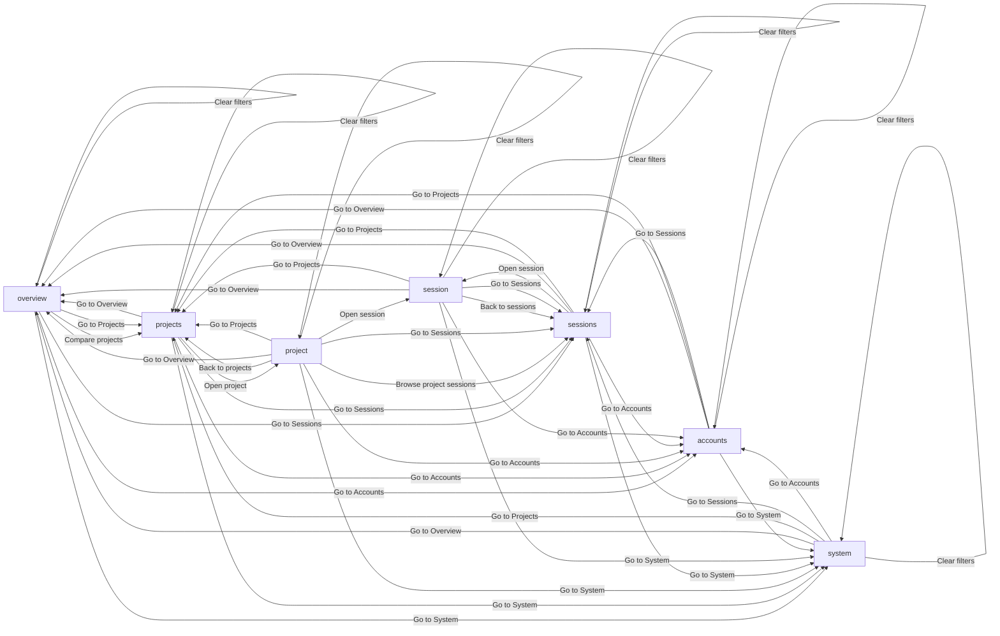

---
ddx:
  id: UF-002
  type: user-flow
  authoring:
    home: repo
  links: [FEAT-002, US-001, US-002, US-003, UJM-001, UJM-002, UJM-003]
---

# UF-002: Unified reporting investigation

**Feature**: FEAT-002 | **Solution design**: existing reporting architecture and contracts; no new runtime design | **Journey maps**: UJM-001, UJM-002, UJM-003

## Scope

- **Covers**: reporting investigation and placement of current account/system surfaces.
- **Entry points**: primary/secondary navigation and direct project/session links.
- **Exits**: browser navigation or closing the report. No external mutation occurs.
- **Size classes**: compact, medium, expanded/large; same destinations, different frame.
- **Out of scope**: redesigning administrative forms or changing billing/capture policy.

## Views

| View | Kind | Purpose | Stories | Wireframe |
|---|---|---|---|---|
| Overview | screen | Establish scope and find the largest consumption or expense driver | US-001 | [[UF-002-01-overview]] |
| Projects | screen | Compare human projects and select one for investigation | US-001 | [[UF-002-02-projects]] |
| Project detail | screen | Explain a human project through folders, sessions and work | US-001 | [[UF-002-03-project]] |
| Sessions | screen | Find a session by ID, title, folder, agent or time | US-003 | [[UF-002-04-sessions]] |
| Session detail | screen | Read a session and explain its usage and attribution | US-003 | [[UF-002-05-session]] |
| Accounts | screen | Inspect remaining capacity, resets and expense evidence | US-002 | [[UF-002-06-accounts]] |
| System | screen | Investigate capture, delivery, reporting and host health | US-001 | [[UF-002-07-system]] |

## Flow Diagram

Entry is any direct view link. Every navigation action preserves scope. Node IDs
are the same stable screen identifiers used by the SDK blueprint. State outcomes
are in the wireframes; this flow has no independent decision screen.

## Transitions

| Action | From | Control | Guard | To | Feedback | Changed region |
|---|---|---|---|---|---|---|
| Compare projects | Overview | Compare projects control | None | Projects | Loading then current publication, or recoverable error; scope retained | Main view |
| Apply scope | Overview | Apply scope control | Valid scope | Overview | Loading then current publication, or recoverable error; scope retained | Report body |
| Refresh | Overview | Refresh control | None | Overview | Loading then current publication, or recoverable error; scope retained | Report body |
| Retry | Overview | Retry control | None | Overview | Loading then current publication, or recoverable error; scope retained | Report body |
| Clear filters | Overview | Clear filters control | None | Overview | Loading then current publication, or recoverable error; scope retained | Report body |
| Go to Projects | Overview | Projects navigation link | None | Projects | Scope preserved; heading focused | Main view |
| Go to Sessions | Overview | Sessions navigation link | None | Sessions | Scope preserved; heading focused | Main view |
| Go to Accounts | Overview | Accounts navigation link | None | Accounts | Scope preserved; heading focused | Main view |
| Go to System | Overview | System navigation link | None | System | Scope preserved; heading focused | Main view |
| Open project | Projects | Open project control | None | Project detail | Loading then current publication, or recoverable error; scope retained | Main view |
| Apply scope | Projects | Apply scope control | Valid scope | Projects | Loading then current publication, or recoverable error; scope retained | Report body |
| Refresh | Projects | Refresh control | None | Projects | Loading then current publication, or recoverable error; scope retained | Report body |
| Retry | Projects | Retry control | None | Projects | Loading then current publication, or recoverable error; scope retained | Report body |
| Clear filters | Projects | Clear filters control | None | Projects | Loading then current publication, or recoverable error; scope retained | Report body |
| Go to Overview | Projects | Overview navigation link | None | Overview | Scope preserved; heading focused | Main view |
| Go to Sessions | Projects | Sessions navigation link | None | Sessions | Scope preserved; heading focused | Main view |
| Go to Accounts | Projects | Accounts navigation link | None | Accounts | Scope preserved; heading focused | Main view |
| Go to System | Projects | System navigation link | None | System | Scope preserved; heading focused | Main view |
| Open session | Project detail | Open session control | None | Session detail | Loading then current publication, or recoverable error; scope retained | Main view |
| Browse project sessions | Project detail | Browse project sessions control | None | Sessions | Loading then current publication, or recoverable error; scope retained | Main view |
| Back to projects | Project detail | Back to projects control | None | Projects | Loading then current publication, or recoverable error; scope retained | Main view |
| Apply scope | Project detail | Apply scope control | Valid scope | Project detail | Loading then current publication, or recoverable error; scope retained | Report body |
| Refresh | Project detail | Refresh control | None | Project detail | Loading then current publication, or recoverable error; scope retained | Report body |
| Retry | Project detail | Retry control | None | Project detail | Loading then current publication, or recoverable error; scope retained | Report body |
| Clear filters | Project detail | Clear filters control | None | Project detail | Loading then current publication, or recoverable error; scope retained | Report body |
| Go to Overview | Project detail | Overview navigation link | None | Overview | Scope preserved; heading focused | Main view |
| Go to Projects | Project detail | Projects navigation link | None | Projects | Scope preserved; heading focused | Main view |
| Go to Sessions | Project detail | Sessions navigation link | None | Sessions | Scope preserved; heading focused | Main view |
| Go to Accounts | Project detail | Accounts navigation link | None | Accounts | Scope preserved; heading focused | Main view |
| Go to System | Project detail | System navigation link | None | System | Scope preserved; heading focused | Main view |
| Open session | Sessions | Open session control | None | Session detail | Loading then current publication, or recoverable error; scope retained | Main view |
| Apply scope | Sessions | Apply scope control | Valid scope | Sessions | Loading then current publication, or recoverable error; scope retained | Report body |
| Refresh | Sessions | Refresh control | None | Sessions | Loading then current publication, or recoverable error; scope retained | Report body |
| Retry | Sessions | Retry control | None | Sessions | Loading then current publication, or recoverable error; scope retained | Report body |
| Clear filters | Sessions | Clear filters control | None | Sessions | Loading then current publication, or recoverable error; scope retained | Report body |
| Go to Overview | Sessions | Overview navigation link | None | Overview | Scope preserved; heading focused | Main view |
| Go to Projects | Sessions | Projects navigation link | None | Projects | Scope preserved; heading focused | Main view |
| Go to Accounts | Sessions | Accounts navigation link | None | Accounts | Scope preserved; heading focused | Main view |
| Go to System | Sessions | System navigation link | None | System | Scope preserved; heading focused | Main view |
| Back to sessions | Session detail | Back to sessions control | None | Sessions | Loading then current publication, or recoverable error; scope retained | Main view |
| Apply scope | Session detail | Apply scope control | Valid scope | Session detail | Loading then current publication, or recoverable error; scope retained | Report body |
| Refresh | Session detail | Refresh control | None | Session detail | Loading then current publication, or recoverable error; scope retained | Report body |
| Retry | Session detail | Retry control | None | Session detail | Loading then current publication, or recoverable error; scope retained | Report body |
| Clear filters | Session detail | Clear filters control | None | Session detail | Loading then current publication, or recoverable error; scope retained | Report body |
| Go to Overview | Session detail | Overview navigation link | None | Overview | Scope preserved; heading focused | Main view |
| Go to Projects | Session detail | Projects navigation link | None | Projects | Scope preserved; heading focused | Main view |
| Go to Sessions | Session detail | Sessions navigation link | None | Sessions | Scope preserved; heading focused | Main view |
| Go to Accounts | Session detail | Accounts navigation link | None | Accounts | Scope preserved; heading focused | Main view |
| Go to System | Session detail | System navigation link | None | System | Scope preserved; heading focused | Main view |
| Apply scope | Accounts | Apply scope control | Valid scope | Accounts | Loading then current publication, or recoverable error; scope retained | Report body |
| Refresh | Accounts | Refresh control | None | Accounts | Loading then current publication, or recoverable error; scope retained | Report body |
| Retry | Accounts | Retry control | None | Accounts | Loading then current publication, or recoverable error; scope retained | Report body |
| Clear filters | Accounts | Clear filters control | None | Accounts | Loading then current publication, or recoverable error; scope retained | Report body |
| Go to Overview | Accounts | Overview navigation link | None | Overview | Scope preserved; heading focused | Main view |
| Go to Projects | Accounts | Projects navigation link | None | Projects | Scope preserved; heading focused | Main view |
| Go to Sessions | Accounts | Sessions navigation link | None | Sessions | Scope preserved; heading focused | Main view |
| Go to System | Accounts | System navigation link | None | System | Scope preserved; heading focused | Main view |
| Apply scope | System | Apply scope control | Valid scope | System | Loading then current publication, or recoverable error; scope retained | Report body |
| Refresh | System | Refresh control | None | System | Loading then current publication, or recoverable error; scope retained | Report body |
| Retry | System | Retry control | None | System | Loading then current publication, or recoverable error; scope retained | Report body |
| Clear filters | System | Clear filters control | None | System | Loading then current publication, or recoverable error; scope retained | Report body |
| Go to Overview | System | Overview navigation link | None | Overview | Scope preserved; heading focused | Main view |
| Go to Projects | System | Projects navigation link | None | Projects | Scope preserved; heading focused | Main view |
| Go to Sessions | System | Sessions navigation link | None | Sessions | Scope preserved; heading focused | Main view |
| Go to Accounts | System | Accounts navigation link | None | Accounts | Scope preserved; heading focused | Main view |

Expand evidence / Collapse evidence changes only the current disclosure and is
reversible without a request. Apply scope validates before dispatching; errors
remain beside the relevant field. Browser Back restores the preceding view/scope.

## Alternate Paths

| Path | Trigger | Transitions | Recovery |
|---|---|---|---|
| Error / offline / slow | Any navigation, Apply scope, Refresh, Retry or Clear filters cannot load | Requested action → current view's corresponding state | Keep scope and last completed results; Retry reissues selected backend |
| Cancel | Leave during any pending read | Go to destination / browser Back | Discard obsolete response; preserve previous scope in history |
| Empty | Any report read has no matching records | Requested action → empty → Clear filters | Reset optional scope explicitly; missing trace bodies instead use partial state |
| Permission denied | Governed cloud read denied | Requested action → permission-denied → Retry | Explain access; backend switch requires explicit selection |
| Partial | Missing rate, payer, trace, publication or work evidence | Requested action → partial → Expand evidence | Group affected counts by cause; retain known facts and uncertain attribution |

## Story Traceability

| Journey | Task | Stories / ACs | Path |
|---|---|---|---|
| Explain project spending | Explain project spending | US-001-AC1/2/3/4, US-003-AC4 | Apply scope → Compare projects → Open project → Open session → Expand evidence |
| Inspect account capacity | Inspect remaining capacity | US-002-AC1/2/3/4 | Go to Accounts → Expand evidence |
| Inspect trace | Inspect a session | US-003-AC1/2/3/4 | Go to Sessions → Apply scope → Open session → Back to sessions |

## Dead Ends

None. Every view exposes the same navigation and backend choice; details also
have a named parent path. Empty/error/denied states retain these exits.
